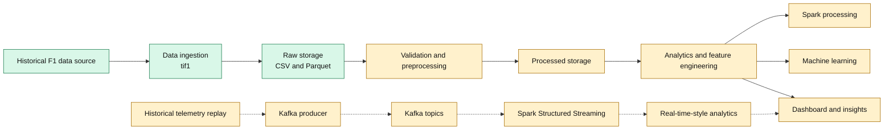

# F1 Telemetry Intelligence

F1 Telemetry Intelligence is an engineering project for collecting, organizing,
and analysing historical Formula 1 race and telemetry data. It currently
provides a reproducible `tif1`-based ingestion experiment and is intended to
grow into a platform for driver comparison, telemetry feature engineering,
lap-performance analysis, and lap-time prediction.

The project is deliberately staged: the current repository contains the
historical batch-ingestion foundation, while distributed processing, streaming,
machine learning, and dashboard components are roadmap items rather than
completed functionality.

## Table of Contents

- [Why are we building this project?](#why-are-we-building-this-project)
- [Problem statement](#problem-statement)
- [Objectives](#objectives)
- [Key features](#key-features)
- [Technology stack](#technology-stack)
- [System architecture](#system-architecture)
- [Architecture responsibilities](#architecture-responsibilities)
- [Complete project workflow](#complete-project-workflow)
- [Repository structure](#repository-structure)
- [Current implementation status](#current-implementation-status)
- [Expected outcomes](#expected-outcomes)
- [Installation and setup](#installation-and-setup)
- [Data and reproducibility](#data-and-reproducibility)
- [Research and evaluation direction](#research-and-evaluation-direction)
- [Future enhancements](#future-enhancements)
- [License and acknowledgements](#license-and-acknowledgements)

## Why are we building this project?

Formula 1 produces detailed measurements of vehicle and race behaviour.
Signals such as speed, throttle, braking, RPM, gear selection, distance, and
driver-ahead information can help explain how performance changes around a
circuit. Comparing drivers is not simply a matter of comparing raw rows:
telemetry must be collected consistently, aligned by lap and track distance,
validated, and transformed into useful features.

This project applies data-engineering and analytics practices to a real-world
motorsport dataset. It provides a practical setting for studying reproducible
batch pipelines, scalable processing, historical telemetry replay, and
predictive modelling without claiming access to live team telemetry.

## Problem statement

The project addresses the challenge of collecting, organizing, preprocessing,
and analysing Formula 1 telemetry and race data in a reproducible way. It aims
to investigate how historical data can be used to:

1. Understand driver performance.
2. Compare driving behaviour.
3. Identify potential performance-loss regions.
4. Extract useful analytical features.
5. Explore lap-time prediction.
6. Design a scalable processing pipeline for telemetry analytics.

These are project objectives; the current implementation does not yet solve all
of them.

## Objectives

- Acquire historical F1 session and telemetry data.
- Store source datasets in structured CSV and Parquet formats.
- Validate and preprocess telemetry.
- Engineer features for driver, lap, and track-distance analysis.
- Compare driver and lap performance.
- Explore lap-time prediction with machine learning.
- Evaluate Apache Spark and PySpark for larger workloads.
- Explore Kafka-based historical telemetry replay.
- Build an interactive analytical dashboard.
- Measure pipeline performance, scalability, and prediction quality.

## Key features

### Currently implemented

- Historical race-session ingestion through `tif1`.
- Lap and per-lap telemetry retrieval.
- CSV and Parquet output.
- JSON collection metadata.
- Logging and failure-record generation.
- Basic dataset inspection and validation scripts.

### Planned

- **Telemetry analytics:** speed, throttle, braking, RPM, gear, driver
  comparisons, and lap-level performance analysis.
- **Big-data processing:** Apache Spark, PySpark, Spark SQL, RDD processing,
  and Scala integration.
- **Streaming:** Kafka producer/consumer topics and Spark Structured
  Streaming for historical telemetry replay.
- **Machine learning:** feature extraction, regression baselines, lap-time
  prediction, and model evaluation.
- **Visualization:** Streamlit/Plotly dashboard, track-distance plots, and
  driver comparison charts.

## Technology stack

| Category | Technology | Status | Purpose |
|---|---|---|---|
| Language | Python | Currently used | Ingestion, data inspection, and profiling |
| Data source | `tif1` | Currently used | Historical F1 session, lap, and telemetry access |
| Data processing | pandas | Currently used | Tabular manipulation and dataset export |
| Storage | CSV | Currently used | Human-readable raw dataset output |
| Storage | Parquet | Currently used | Columnar raw dataset output |
| Metadata | JSON | Currently used | Collection statistics and schema metadata |
| Distributed processing | Apache Spark / PySpark / Spark SQL | Planned | Scalable batch and structured processing |
| Distributed processing | Scala / RDDs | Planned | Spark integration experiments |
| Streaming | Apache Kafka | Planned | Historical telemetry event replay |
| Streaming | Spark Structured Streaming | Planned | Stream processing experiments |
| Machine learning | scikit-learn or Spark MLlib | Planned | Lap-time prediction experiments |
| Visualization | Streamlit and Plotly | Planned | Interactive analytical dashboard |
| Version control | Git / GitHub | Intended | Source and documentation versioning |

No dependency manifest is currently present. Local environments exist, but
their installed packages are not a substitute for a reproducible manifest.

## System architecture

The solid path represents the implemented batch foundation. Dashed components
are planned or exploratory.



The optional streaming path replays historical records to simulate event
processing. It is not genuine live Formula 1 team telemetry.

## Architecture responsibilities

| Layer | Responsibility | Relevant technology | Status |
|---|---|---|---|
| Data source | Provide historical session, lap, and telemetry records | `tif1` | Implemented |
| Ingestion | Retrieve sessions, drivers, laps, and telemetry; record failures | Python | Implemented |
| Raw storage | Preserve source-shaped datasets for repeatable analysis | CSV, Parquet | Implemented |
| Preprocessing | Validate, clean, align, and normalize telemetry | pandas; future pipeline | Planned |
| Processed storage | Store analysis-ready tables and features | Parquet | Planned |
| Analytics | Compare drivers and identify performance patterns | pandas; future SQL | Partially started |
| Big-data processing | Scale transformations and queries | Spark, PySpark, Scala | Planned |
| Streaming | Replay telemetry events and process streams | Kafka, Spark Structured Streaming | Planned |
| Machine learning | Train and evaluate lap-time models | scikit-learn or MLlib | Planned |
| Visualization | Present telemetry and performance insights | Streamlit, Plotly | Planned |
| Testing and documentation | Validate data contracts and explain experiments | Python scripts, Markdown | Partially started |

## Complete project workflow

The intended end-to-end workflow is:

1. Retrieve historical Formula 1 session data.
2. Extract lap information and per-lap telemetry.
3. Store original datasets in raw storage.
4. Generate collection metadata.
5. Validate schema, completeness, and quality.
6. Handle missing or invalid values explicitly.
7. Align telemetry by lap and track distance.
8. Generate analytical features.
9. Perform driver and lap comparisons.
10. Process larger workloads with Spark.
11. Optionally replay historical telemetry through Kafka.
12. Train and evaluate machine-learning models.
13. Display results through a dashboard.
14. Evaluate throughput, latency, scalability, and document findings.

Only the early ingestion, raw export, metadata, logging, and basic inspection
steps are currently implemented.

## Repository structure

Existing directories and files are shown first; empty directories are planned
extension points rather than evidence of completed modules.

```text
F1-Telemetry-Intelligence/
├── data/
│   ├── raw/                    # Generated source datasets (ignored by Git)
│   ├── processed/              # Planned analysis-ready datasets
│   └── metadata/               # Collection metadata (kept trackable)
├── src/
│   ├── ingestion/
│   │   └── collect_race_data.py
│   ├── preprocessing/
│   │   └── profile_telemetry.py
│   ├── analytics/              # Planned
│   ├── streaming/              # Planned
│   └── ml/                     # Planned
├── dashboard/                  # Planned
├── docs/                       # Documentation extension point
├── notebooks/                  # Experiment extension point
├── tests/
│   └── validate_ingestion.py
├── audit_dataset.py            # Local dataset audit
├── inspect_data.py             # Local dataset inspection
├── test_tif1.py                # Initial source-access experiment
├── .gitignore
└── README.md
```

## Current implementation status

| Area | Status | Evidence |
|---|---|---|
| Repository setup | In progress | Project directories exist; no tracked files or dependency manifest yet |
| Python environment | In progress | Local `.venv` and `.venv-tif1` environments exist; `tif1` is available in the latter |
| Historical data ingestion | Completed for one experiment | `src/ingestion/collect_race_data.py` |
| CSV/Parquet storage | Completed for the experiment | Generated files under `data/raw/` |
| Metadata generation | Completed for the experiment | `data/metadata/2024_abu_dhabi_metadata.json` |
| Data profiling | Completed (Phase 3) | `src/preprocessing/profile_telemetry.py`, `docs/data_dictionary.md`, `reports/data_profiling_report/` |
| Data preprocessing | Completed (Phase 4) | `src/preprocessing/preprocess_pipeline.py`, `data/processed/abu_dhabi_2024/`, `reports/preprocessing_report/` |
| Exploratory analytics | Upcoming (Phase 5) | Inspection and audit scripts exist; analysis module is next |
| Feature engineering | Upcoming (Phase 6) | Planned |
| Spark integration | Planned (Phase 7) | No Spark source or configuration found |
| Kafka integration | Planned (Phase 8) | No producer, consumer, or topic configuration found |
| Machine learning | Planned (Phase 9) | No model or evaluation pipeline found |
| Dashboard | Planned (Phase 10) | Dashboard directory is currently empty |
| Automated tests | Completed | `tests/test_profile_telemetry.py`, `tests/test_preprocessing_pipeline.py`, full suite (40 tests) |

### Verified experiment snapshot

The existing metadata and Parquet files describe:

- 2024 Abu Dhabi Grand Prix, Race session.
- 20 drivers.
- 1,035 race-lap records across 46 columns.
- 96 successful driver-lap telemetry records.
- 72,476 telemetry samples across 26 columns.
- 0 failed telemetry retrieval records.

These are observations from one collection run, not project-wide limits.

## Expected outcomes

The roadmap is intended to produce a reproducible historical ingestion
pipeline, validated and structured telemetry datasets, driver-performance
analysis, telemetry-based insights, lap-time prediction experiments, scalable
processing, a streaming simulation, and an interactive dashboard.

Together, these deliverables demonstrate practical skills in data acquisition,
schema and quality handling, columnar storage, distributed systems, streaming
design, modelling, visualization, testing, and technical communication.

## Installation and setup

### Prerequisites

- Python 3.14 or a compatible version supported by the installed `tif1`
  environment.
- Network access to the historical data provider when collecting a new
  session.

There is currently no `requirements.txt` or `pyproject.toml`. The commands
below use the existing local `tif1` environment; create a dependency manifest
before asking other contributors to reproduce the setup.

### Clone and activate on Windows PowerShell

```powershell
git clone https://github.com/ridddhhimaaa/F1-Telemetry-Intelligence.git
Set-Location F1-Telemetry-Intelligence
.\.venv-tif1\Scripts\Activate.ps1
```

If the environment does not exist, create a fresh environment and install the
dependencies required by the ingestion script (including `tif1`, `pandas`, and
Parquet support) according to the provider's current installation guidance.

### Activate on Linux or macOS

```bash
git clone https://github.com/ridddhhimaaa/F1-Telemetry-Intelligence.git
cd F1-Telemetry-Intelligence
source .venv-tif1/bin/activate
```

### Run the existing ingestion script

```powershell
python src\ingestion\collect_race_data.py
```

The script retrieves the configured 2024 Abu Dhabi Race session and writes
datasets to `data/raw/`, metadata to `data/metadata/`, and logs to `logs/`.
The generated data and runtime logs are intentionally ignored by Git.

The repository also contains local inspection scripts:

```powershell
python src\preprocessing\profile_telemetry.py
python tests\validate_ingestion.py
```

These scripts expect the corresponding Parquet files to exist and are
diagnostic scripts, not a fully configured automated test suite.

## Data and reproducibility

The current source is `tif1`, which provides access to historical Formula 1
session data. The ingestion script preserves raw-shaped lap and telemetry
outputs in both CSV and Parquet and writes JSON metadata containing the
collection parameters, counts, selected drivers, and telemetry schema.

Runtime caches, logs, raw datasets, and processed datasets are excluded by
`.gitignore`; metadata is intentionally not excluded. A small, explicitly
redistributable sample may be added later if its source terms permit it.
Users should not assume that Formula 1 data is owned by this project or freely
redistributable. Availability and access restrictions depend on the provider.
For reproducibility, record the source, session, collection time, environment,
and code revision for each experiment.

## Research and evaluation direction

Potential research questions include:

- Can telemetry patterns explain differences in driver performance?
- Can track-distance-aligned telemetry identify where time is lost?
- Can historical lap and telemetry features predict lap performance on unseen
  sessions?
- Does distributed processing provide measurable benefits for larger workloads?
- What throughput and latency result from a Kafka-to-Spark replay pipeline?

Meaningful evaluation requires baselines, session-aware train/test separation,
leakage prevention, and measurable metrics. No model results or performance
benchmarks are claimed by the current repository.

## Future enhancements

1. Support multiple seasons, events, and session types.
2. Improve automated data-quality and schema validation.
3. Add track-distance alignment and telemetry normalization.
4. Develop driver-performance comparison metrics.
5. Add corner-level analysis.
6. Implement and evaluate lap-time prediction models.
7. Compare baseline and advanced models.
8. Integrate Apache Spark and PySpark.
9. Develop Kafka-based historical telemetry replay.
10. Add Spark Structured Streaming.
11. Explore GraphX for driver-ahead or racing relationships where justified.
12. Build a Streamlit and Plotly dashboard.
13. Add automated testing and pipeline monitoring.
14. Evaluate throughput, latency, and scalability.

## License and acknowledgements

No license has been selected for this repository yet. Until a license is
added, reuse and redistribution permissions should not be assumed.

This project acknowledges the `tif1` open-source tooling and the historical
data provider made available through it. Consult the provider and tool licenses
and terms before redistributing collected data.
