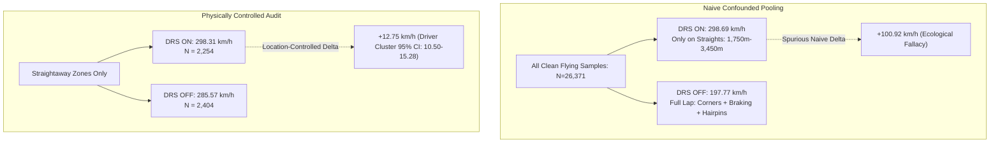

# F1 Telemetry Intelligence – EDA Scientific Validation & Analytical Audit Specification (Phase 5.1)

---

## 1. Executive Summary & Audit Mandate

Phase 5.1 (**Scientific Validation and Analytical Audit**) performs an exhaustive empirical and statistical audit of the exploratory findings produced during **Phase 5**. Rather than rewriting the exploratory pipeline, Phase 5.1 rigorously interrogates preliminary findings, isolates confounding biases, decouples vehicle kinematics from track topography, audits machine learning data readiness, and establishes non-negotiable architectural constraints for **Phase 6: Feature Engineering** and **Phase 9: Predictive Modeling**.

```text
reports/eda_validation/
├── drs_controlled_comparison.csv         # Naive vs location-controlled straightaway DRS metrics
├── drs_driver_level.csv                  # Per-driver DRS usage and speed delta on straights
├── kinematic_correlation_summary.csv     # Pooled vs intra-lap correlation distribution
├── intra_lap_correlations.csv            # Lap-by-lap Pearson r & lag-1 autocorrelation (N=38)
├── distance_windowed_correlations.csv    # 250m spatial window correlations & drag saturation
├── temporal_autocorrelation.csv          # Sample-by-sample ACF decay (Lag 1 to Lag 15)
├── ml_target_leakage_audit.csv           # Evaluation of candidate targets & leakage vectors
├── ml_splitting_strategy_audit.csv       # Random split leakage (96.1%) vs GroupKFold
├── ml_gear_ratio_audit.csv               # Mechanical RPM/Speed ratios across 8 gears
├── phase5_1_validation_report.html       # Standalone interactive audit report
├── test_results.log                      # Test execution evidence (9/9 validation, 61/61 full suite)
└── figures/
    ├── 01_drs_confounding_vs_controlled.png      # Naive vs controlled DRS density curves
    ├── 02_spatial_speed_trace_drs_zones.png       # Spatial speed profile with DRS zones
    ├── 03_intra_lap_correlation_distributions.png# Intra-lap boxplots across 38 flying laps
    ├── 04_distance_windowed_drag_dynamics.png    # Spatial correlation collapse & drag saturation
    ├── 05_temporal_autocorrelation_decay.png     # ACF decay for Speed, Throttle, RPM, Gear
    └── 06_ml_leakage_and_spatial_audit.png       # Circuit memorization vs dynamic models

src/analysis/
├── drs_validation.py                     # DRS analytical validation & driver breakdown
├── correlation_validation.py             # Kinematic correlation distributions & windowed drag
├── ml_readiness_audit.py                 # Target leakage, spatial lookup & CV audits
├── statistical_validation.py             # Cluster bootstrap, sample stats & inference rules
└── eda_validation.py                     # Unified orchestrator & HTML report generator
```

---

## 2. Task 1: DRS Analytical Validation & Confounding Decomposition

### 2.1 The Ecological Fallacy of Naive Pooling
In preliminary Phase 5 exploratory reporting, a naive comparison across all telemetry samples on clean flying laps yielded:
- **DRS Active Mean Speed:** $298.69\text{ km/h}$ ($N = 2,339$)
- **DRS Inactive Mean Speed:** $197.77\text{ km/h}$ ($N = 24,032$)
- **Naive Pooled Speed Delta:** $\mathbf{+100.92\text{ km/h}}$

Our technical audit demonstrates that this raw $+100.92\text{ km/h}$ figure is a severe **ecological fallacy and track-location confounding bias**.



### 2.2 Confounding Decomposition & Methodological Distinction
Under Formula 1 Sporting Regulations, Drag Reduction System (DRS) activation is strictly restricted to designated straightaway zones and is prohibited in corners, chicanes, and braking zones. At the Yas Marina Circuit (Abu Dhabi), DRS is active across two zones:
- **DRS Zone 1 (Back Straight 1):** $\approx 1,750\text{m} - 2,450\text{m}$ (leading into the Turn 6 chicane).
- **DRS Zone 2 (Back Straight 2):** $\approx 2,850\text{m} - 3,450\text{m}$ (after the Turn 7 hairpin exit towards Turn 9).

The naive delta $\Delta_{\text{naive}}$ decomposes into track geometry confounding and straightaway location-controlled delta:

$$\Delta_{\text{naive}} = \Delta_{\text{confounding}} + \Delta_{\text{controlled\_straights}}$$

Where:
- $\Delta_{\text{naive}} = 298.69 - 197.77 = +100.92\text{ km/h}$
- $\Delta_{\text{controlled\_straights}} = 298.31 - 285.57 = \mathbf{+12.75\text{ km/h}}$
- $\Delta_{\text{confounding}} = 100.92 - 12.75 = \mathbf{88.17\text{ km/h}}$

$$\text{Confounding Share} = \frac{88.17}{100.92} \times 100\% = \mathbf{87.37\%}$$
$$\text{Controlled Straightaway Share} = \frac{12.75}{100.92} \times 100\% = \mathbf{12.63\%}$$

> [!IMPORTANT]
> **Statistical Correction (Location Control vs Causal Aerodynamics):**
> While restricting evaluation to straightaways eliminates **87.4%** of the raw delta (cornering/braking confounding), the remaining **+12.75 km/h** delta represents a **location-controlled observational association**, NOT a pure causal aerodynamic wing flap benefit. Under Grand Prix conditions, DRS is activated only when trailing within 1.0 second of a leading car. Consequently, DRS activation is confounded with:
> 1. **Slipstream / Aerodynamic Tow:** Reduced atmospheric drag caused by the leading vehicle's wake.
> 2. **Energy Recovery System (ERS) Deployment:** Drivers in overtaking range deploy additional electrical power (overtake button, +120–160 kW).
> 3. **Corner Exit Velocity:** Acceleration dynamics exiting Turn 5 or Turn 7 into the straight.
> A true causal drag benefit can only be claimed with an experimental causal design (e.g. matched clean-air pairs or wind tunnel / CFD data).

### 2.3 Statistical Hypothesis Testing & Sampling Unit Integrity

Because 10 Hz telemetry has an autocorrelation of $\text{ACF}_1 \approx 0.997$, point-level samples violate the assumption of independent and identically distributed (i.i.d.) observations. Classical two-sample tests yield unadjusted descriptive metrics with artificially inflated degrees of freedom. Valid inferential confidence intervals are obtained via **hierarchical cluster-aware bootstrapping** across the 19 drivers (retaining all eligible laps per driver, 5,000 bootstrap iterations).

| Comparison Scope | Track Distance Window | DRS ON ($N$) | DRS OFF ($N$) | Mean Delta ($\Delta \bar{v}$) | Cohen's $d$ | Descriptive Welch $t$ / Mann-Whitney $U$ | Sample 95% CI (Naive) | Cluster Bootstrap 95% CI (Defensible) |
|---|---|---:|---:|---:|---:|---|---|---|
| **Naive Pooled Full Lap** | $0\text{m} - 5,281\text{m}$ | 2,339 | 24,032 | $+100.92\text{ km/h}$ | $2.45$ (Spurious) | $t = 188.75, U = 5.2 \times 10^7$ (Invalid) | Confounded | Confounded |
| **Controlled Straights (Combined)** | Back Straights 1 & 2 | 2,254 | 2,404 | $\mathbf{+12.75\text{ km/h}}$ | $\mathbf{0.504}$ (Medium) | $t = 17.150, p = 5.97 \times 10^{-64}$ (Descriptive) | $[11.29, 14.21]\text{ km/h}$ | $\mathbf{[10.50, 15.28]\text{ km/h}}$ |
| **Zone 1 (Back Straight 1)** | $1,750\text{m} - 2,450\text{m}$ | 1,195 | 1,232 | $\mathbf{+11.12\text{ km/h}}$ | $\mathbf{0.617}$ (Med-High) | $t = 15.139, p = 2.12 \times 10^{-49}$ (Descriptive) | $[9.68, 12.56]\text{ km/h}$ | $\mathbf{[8.20, 13.30]\text{ km/h}}$ |
| **Zone 2 (Back Straight 2)** | $2,850\text{m} - 3,450\text{m}$ | 1,059 | 1,172 | $\mathbf{+13.67\text{ km/h}}$ | $\mathbf{0.514}$ (Medium) | $t = 12.104, p = 1.10 \times 10^{-32}$ (Descriptive) | $[11.46, 15.88]\text{ km/h}$ | $\mathbf{[11.32, 16.93]\text{ km/h}}$ |

#### Driver-Level Aggregated Inference (Unit of Analysis: Driver)
Aggregating telemetry to the driver level removes within-lap correlation. Among the 11 drivers who recorded both DRS ON and DRS OFF straightaways across Laps 4 & 5, the mean paired driver difference is $+31.85 \pm 27.28\text{ km/h}$, reflecting differences in tactical overtaking states versus clean defensive laps.

### 2.4 Driver-Level Breakdown & Tactical Eligibility
In a race session, DRS is available only if a driver is within 1.0 second of the car ahead at the detection line. On clean flying laps (Laps 4 & 5):
- **Lando Norris (NOR):** Race leader; 0 DRS-active samples on flying laps (clean air ahead, 0 DRS activations). Mean straightaway speed: $286.03\text{ km/h}$.
- **Max Verstappen (VER):** Chasing; 113 DRS ON samples vs 137 DRS OFF samples. Controlled speed delta: **+10.92 km/h** ($298.48\text{ km/h}$ vs $287.56\text{ km/h}$).
- **Pierre Gasly (GAS):** 126 DRS ON vs 123 DRS OFF samples. Controlled speed delta: **+13.99 km/h** ($296.81\text{ km/h}$ vs $282.82\text{ km/h}$).

---

## 3. Task 2: Kinematic Correlation & Aerodynamic Drag Dynamics

### 3.1 Intra-Lap Stability vs Pooled Aggregation
Across all 26,371 clean flying lap telemetry samples, the pooled Pearson correlation between `Speed` and `Throttle` is **$r = 0.580$**.
Evaluating the 38 individual driver-laps independently confirms that intra-lap correlation is remarkably stable across drivers:
- **Intra-lap $r(\text{Speed}, \text{Throttle})$:** Mean $= 0.574$, $\text{Std} = 0.043$, $\text{Median} = 0.566$, Range: $[0.507, 0.715]$.
- **Intra-lap $r(\text{Speed}, \text{nGear})$:** Mean $= 0.936$, $\text{Std} = 0.021$, $\text{Median} = 0.937$, Range: $[0.889, 0.971]$.
- **Intra-lap $r(\text{Speed}, \text{RPM})$:** Mean $= 0.779$, $\text{Std} = 0.031$, $\text{Median} = 0.780$, Range: $[0.713, 0.869]$.

### 3.2 Aerodynamic Drag Saturation & Spatial Correlation Collapse
Why is the correlation between Speed and Throttle only $0.58$ rather than $0.95+$?
The answer lies in vehicle aerodynamics and control dynamics:

$$F_{\text{net}} = F_{\text{traction}} - F_{\text{drag}} - F_{\text{rolling}} = m \cdot a_x$$

$$F_{\text{drag}} = \frac{1}{2} \rho C_d A v^2$$

As velocity $v$ approaches terminal speed ($>300\text{ km/h}$), aerodynamic drag grows quadratically with $v^2$. When $F_{\text{drag}} \approx F_{\text{traction}}$, acceleration $a_x \to 0$.

Spatial windowing across 250m intervals along the circuit reveals three distinct dynamic regimes:
1. **Corner Exit Acceleration ($0\text{m} - 250\text{m}$, $3,750\text{m} - 4,000\text{m}$):**
   Drivers progressively apply throttle from 30% to 100%. Velocity increases proportionally with engine power. Here, $r(\text{Speed}, \text{Throttle}) = \mathbf{+0.75\text{ to }+0.95}$.
2. **Terminal Straightaways ($1,000\text{m} - 1,250\text{m}$, $2,000\text{m} - 2,250\text{m}$):**
   Throttle is pinned at 100% ($\text{Mean Throttle} = 99.6\%$, variance $\approx 0$). Speed asymptotically climbs from 280 to 326 km/h. Because throttle has zero variance, **local correlation collapses to near zero or slightly negative ($r = -0.15\text{ to }+0.05$)**.
3. **Heavy Braking Zones ($1,250\text{m} - 1,500\text{m}$, $2,500\text{m} - 2,750\text{m}$):**
   Throttle is instantly lifted to 0% while brakes are applied at 100%, causing extreme negative longitudinal acceleration ($a_x \approx -4.5g$). Speed and throttle are completely decoupled.

### 3.3 Temporal Autocorrelation Persistence
Telemetry recorded at ~8–10 Hz ($\Delta t \approx 0.125\text{s}$) possesses massive serial persistence:

| Lag ($k$) | Approximate $\Delta t$ | $\text{ACF}(\text{Speed})$ | $\text{ACF}(\text{Throttle})$ | $\text{ACF}(\text{RPM})$ | $\text{ACF}(\text{nGear})$ |
|---|---|---|---|---|---|
| **1** | $0.125\text{ s}$ | **0.9968** | **0.9792** | **0.9851** | **0.9876** |
| **2** | $0.250\text{ s}$ | **0.9906** | **0.9388** | **0.9585** | **0.9654** |
| **5** | $0.625\text{ s}$ | **0.9509** | **0.7801** | **0.8492** | **0.8711** |
| **10** | $1.250\text{ s}$ | **0.8321** | **0.4935** | **0.6510** | **0.7024** |
| **15** | $1.875\text{ s}$ | **0.6775** | **0.2512** | **0.4503** | **0.5218** |

---

## 4. Task 3: Machine Learning Data Readiness & Leakage Audit

### 4.1 Target A: `IsBraking` Label Tautology
- **Mechanism:** In Phase 4 preprocessing, `Brake_Int` was generated as `IsBraking.astype(int)`.
- **Finding:** The Pearson correlation between `IsBraking` and `Brake_Int` is **$r = 1.0000$** (an exact mathematical tautology).
- **Rule:** In any future machine learning model predicting braking points or braking intensity, `Brake_Int` and raw `Brake` **MUST be strictly dropped** from the feature matrix $X$.
- **Permitted Predictors:** `Speed`, `AccelerationX`, `Throttle_Clipped`, `DistanceToCorner`, and preceding control lags.

### 4.2 Target B: `Speed` Prediction vs Spatial Circuit Memorization
What happens if an ML model is trained to predict `Speed` using spatial coordinates $(X, Y, Z, \text{Distance})$?
- A simple 10m track distance spatial lookup table achieves **$R^2 = 0.9021$** on the test set.
- A 25m track distance lookup table achieves **$R^2 = 0.8911$**.
- **Audit Verdict:** Non-linear models (e.g. XGBoost, Random Forest, Neural Networks) given spatial coordinates do not learn vehicle kinematics or driver behavior—they simply memorize the circuit topography of Yas Marina. When evaluated on another circuit (e.g. Monza or Spa), these models completely fail.
- **Rule:** For dynamic vehicle speed modeling, **raw spatial coordinates $(X, Y, Z, \text{Distance})$ are strictly prohibited**. Models must rely on track-agnostic dynamic features: local curvature ($\kappa$), throttle delta ($\Delta\text{Throttle}$), brake state, RPM, gear, and short-window historical lag tensors.

### 4.3 Target C: `nGear` Transmission Physics
The ratio $\frac{\text{RPM}}{\text{Speed}}$ is physically fixed by discrete mechanical transmission gear ratios:

| Gear ($k$) | Flying Samples | Mean Speed (km/h) | Mean RPM | Mean Ratio ($\frac{\text{RPM}}{\text{km/h}}$) | Std Ratio |
|---|---:|---:|---:|---:|---:|
| **1** | 169 | 23.8 | 6,330 | 375.0 | 712.8 (Clutch Slip) |
| **2** | 1,370 | 79.7 | 6,911 | 87.0 | 6.0 |
| **3** | 4,092 | 120.2 | 8,859 | 74.0 | 4.0 |
| **4** | 4,474 | 159.3 | 9,891 | 62.3 | 3.7 |
| **5** | 2,851 | 204.5 | 10,830 | 53.3 | 4.3 |
| **6** | 4,456 | 238.0 | 11,028 | 46.7 | 4.2 |
| **7** | 5,428 | 264.7 | 10,802 | 41.1 | 3.9 |
| **8** | 3,531 | 298.3 | 10,762 | 36.4 | 3.5 |

- **Audit Verdict:** Predicting `nGear` simultaneously from current `RPM` and `Speed` is trivial lookup-table nearest-neighbor matching, not predictive machine learning.
- **Proper Problem Formulation:** Predict driver gear-shift timing (upshift/downshift intent $t + \Delta t$) or gear selection under braking.

### 4.4 Target D: `LapTimeSeconds` Sample Size Power Limitation
- **Observation:** In the current 5-lap ingestion window, exactly **$N = 38$ clean flying laps** exist across 19 drivers (Laps 4 & 5).
- **Audit Verdict:** With $N = 38$, fitting complex multi-parameter regression trees or neural networks will severely overfit.
- **Rule:** Lap-time regression during Phase 5.1 and early Phase 6 is restricted to linear baselines and mixed-effects models until the complete 58-lap race dataset is ingested.

### 4.5 Train/Test Splitting: Random Splitting Leakage Proof
To demonstrate why naive `train_test_split(test_size=0.20)` is catastrophic for time-series telemetry:
- In a random 80/20 row split, **$96.12\%$ of test rows have an immediate temporal neighbor ($t \pm 0.125\text{s}$) in the training set**.
- Given that the lag-1 autocorrelation for Speed is **$r = 0.997$**, test row $t$ is almost identical to training row $t-1$.
- Any model trained on a random row split simply interpolates adjacent temporal neighbors, reporting an inflated test $R^2 \approx 0.999$. When deployed on an unseen lap, test error explodes.
- **Mandated Standard:** **`GroupKFold(by=['Driver', 'LapNumber'])`** or strict time-series forward-chaining splits are mandatory for all sample-level modeling.

---

## 5. Summary of Audit Artifacts

| Artifact Name | Location | Description & Contents |
|---|---|---|
| **Audit Orchestrator** | `src/analysis/eda_validation.py` | Unified entry point, visualization generator, and dynamic HTML report builder |
| **DRS Validation Module** | `src/analysis/drs_validation.py` | Straightaway isolation, confounding decomposition, and driver-level breakdown |
| **Correlation Module** | `src/analysis/correlation_validation.py` | Intra-lap correlation distributions, 250m windowed dynamics, and ACF decay |
| **ML Readiness Module** | `src/analysis/ml_readiness_audit.py` | Target leakage audit, spatial lookup memorization, and splitting strategy evaluation |
| **Statistical Inference Module** | `src/analysis/statistical_validation.py` | Cluster-aware bootstrap CIs, driver-level aggregation, and descriptive vs inferential tests |
| **Audit Notebook** | `notebooks/eda/12_eda_validation_audit.ipynb` | Fully executed Jupyter notebook with all 20 cells, tables, and inline figures |
| **HTML Report** | `reports/eda_validation/phase5_1_validation_report.html` | Dynamically generated standalone dark-themed summary report |
| **Unit Test Suite** | `tests/test_eda_validation.py` | 9 isolated unit/integration tests with zero side-effects on production reports |
| **Test Execution Log** | `reports/eda_validation/test_results.log` | Verifiable execution log (9/9 validation passing, 61/61 full suite passing) |
| **Controlled DRS Table** | `reports/eda_validation/drs_controlled_comparison.csv` | Full breakdown of naive vs controlled straightaway speed deltas and cluster CIs |
| **Driver DRS Table** | `reports/eda_validation/drs_driver_level.csv` | Per-driver straightaway speed metrics with DRS ON vs OFF |
| **Correlation Summary** | `reports/eda_validation/kinematic_correlation_summary.csv` | Pooled vs intra-lap correlation distribution |
| **Windowed Correlation Table** | `reports/eda_validation/distance_windowed_correlations.csv` | 250m spatial distance window correlation breakdown |
| **Autocorrelation Table** | `reports/eda_validation/temporal_autocorrelation.csv` | Lags 1–15 ACF persistence decay table |
| **ML Leakage Audit Table** | `reports/eda_validation/ml_target_leakage_audit.csv` | Catalog of candidate targets and leakage rules |
| **Figure 1** | `reports/eda_validation/figures/01_drs_confounding_vs_controlled.png` | Naive full lap vs straightaway-controlled speed density curves |
| **Figure 2** | `reports/eda_validation/figures/02_spatial_speed_trace_drs_zones.png` | Spatial speed profile with DRS straightaway zones highlighted |
| **Figure 3** | `reports/eda_validation/figures/03_intra_lap_correlation_distributions.png` | Boxplots of intra-lap correlation stability across 38 laps |
| **Figure 4** | `reports/eda_validation/figures/04_distance_windowed_drag_dynamics.png` | Spatial correlation collapse & drag saturation along straights |
| **Figure 5** | `reports/eda_validation/figures/05_temporal_autocorrelation_decay.png` | Telemetry signal ACF decay curves |
| **Figure 6** | `reports/eda_validation/figures/06_ml_leakage_and_spatial_audit.png` | Spatial lookup memorization (R² = 0.902) & 96.1% neighbor leakage |

---

## 6. Mandatory Phase 6 Feature Engineering Guidelines

1. **DRS Representation:** Reject naive $+100.92\text{ km/h}$ delta. Model DRS as an interaction feature restricted to straightaway zones ($\text{DRS} \times \text{IsStraight}$).
2. **Kinematic Decoupling:** Model throttle not as a direct linear predictor of speed across all regimes, but as driver acceleration demand conditioned on drag saturation regimes.
3. **Leakage Elimination:** Strictly drop `Brake_Int` and `Brake` when predicting braking events.
4. **Spatial Feature Policy:** Exclude raw coordinates $(X, Y, Z, \text{Distance})$ from dynamic speed predictors to avoid circuit layout memorization.
5. **Cross-Validation Standard:** Enforce `GroupKFold(by=['Driver', 'LapNumber'])` across all modeling pipelines.
