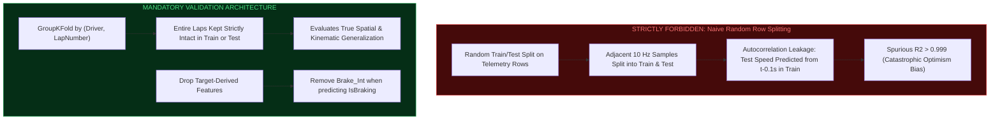

# F1 Telemetry Intelligence – Exploratory Data Analysis (EDA) Specification (Phase 5)

---

## 1. Purpose & Analytical Objectives

Phase 5 (**Exploratory Data Analysis**) builds upon the cleansed, validated, and spatially synchronized datasets produced in **Phase 4** and audited in **Phase 4.1**. Its primary objective is to extract empirical domain insights, profile driver kinematics, map circuit topography, evaluate cross-signal physical dependencies, and rigorously assess dataset readiness for downstream **Feature Engineering (Phase 6)**, **Big Data Streaming (Phases 7 & 8)**, and **Predictive Modeling (Phase 9)**.

### Core Principles
1. **Physical Grounding:** Telemetry observations are interpreted strictly through Formula 1 vehicle dynamics, aerodynamics, and powertrain constraints.
2. **Tactical Regime Awareness:** High-speed benchmark analysis is restricted to clean green-flag flying laps (Laps 4 & 5), isolating Virtual Safety Car (Laps 2 & 3) and standing start (Lap 1) regimes.
3. **No Synthetic Manipulation:** Data distributions are examined without modifying or discarding processed datasets.
4. **Machine Learning Preparation:** A dedicated ML readiness audit evaluates prediction targets, data leakage risks, multicollinearity, and validation splitting strategies without fitting premature predictive models.

---

## 2. Dataset Architecture & Primary Inputs

The EDA workflow evaluates three interconnected datasets stored in `data/processed/abu_dhabi_2024/`:

| Dataset Entity | Format | File Path | Dimensions | Granularity & Description |
|---|---|---|---|---|
| **Processed Telemetry** | Parquet | `data/processed/abu_dhabi_2024/processed_telemetry.parquet` | 72,476 rows $\times$ 37 cols | Time-domain sensor channels (~8–10 Hz) covering first 5 laps per driver |
| **Processed Race Laps** | Parquet | `data/processed/abu_dhabi_2024/processed_race_laps.parquet` | 1,035 rows $\times$ 48 cols | Official FIA lap-level timing, compound, stint, and weather records (58 laps) |
| **Resampled Telemetry** | Parquet | `data/processed/abu_dhabi_2024/resampled_telemetry.parquet` | 495,849 rows $\times$ 18 cols | Synchronized 1.0-metre track distance slices across 95 eligible driver-laps |

---

## 3. Modular Architecture: Notebooks & Python Modules

The Phase 5 codebase enforces a strict separation of concerns: reusable analytics are encapsulated in `src/analysis/`, while interactive experimentation is organized across 11 standalone Jupyter notebooks in `notebooks/eda/`.

```text
notebooks/eda/
├── 01_dataset_overview.ipynb              # Dimensions, schema, lap classifications, sampling frequency
├── 02_data_quality_analysis.ipynb          # MNAR nulls, physical bounds, mechanical overtravel
├── 03_driver_performance_analysis.ipynb   # Driver speed boxplots, control aggression, lap pace
├── 04_speed_analysis.ipynb                # Velocity distributions, straightaway terminal speeds, DRS
├── 05_braking_analysis.ipynb              # Circuit braking zones, Turn 6 deceleration points
├── 06_throttle_analysis.ipynb             # Bimodal throttle distribution, operating regimes
├── 07_gear_rpm_analysis.ipynb             # 8-speed transmission gear ratios, engine RPM bands
├── 08_lap_comparison_analysis.ipynb       # Spatial telemetry deltas (NOR vs VER Lap 5)
├── 09_spatial_telemetry_analysis.ipynb    # 2D GPS circuit track map, sector-by-sector metrics
├── 10_correlation_analysis.ipynb          # Pearson/Spearman matrices, correlation vs causation
└── 11_machine_learning_eda.ipynb          # Target feasibility, leakage risks, GroupKFold strategies

src/analysis/
├── __init__.py                            # Package initialization
├── data_loader.py                         # Cached loading, domain filtering, lap segmentation
├── dataset_overview.py                    # Dimension summaries, sampling delta analysis
├── data_quality.py                        # Missing value audits, sensor boundary compliance
├── driver_analysis.py                     # Driver-by-driver speed, throttle, and brake metrics
├── speed_analysis.py                      # Velocity percentiles, DRS acceleration impact
├── braking_analysis.py                    # Heavy braking zone detection, Turn 6 comparisons
├── throttle_analysis.py                   # Bimodal throttle classification, modulation rates
├── gear_rpm_analysis.py                   # Gear usage percentages, shift frequency, RPM rays
├── lap_comparison.py                      # Synchronized spatial deltas (Speed, Throttle, Time)
├── spatial_analysis.py                    # 2D track projection, sector performance breakdown
├── correlation_analysis.py                # Kinematic correlation matrices, pairplot matrices
├── ml_eda.py                              # ML target audits, feature suitability, leakage risk
└── run_all_analyses.py                    # Unified execution pipeline generating reports & figures
```

---

## 4. Key Empirical Findings Across Analytical Domains

### 4.1 Dataset Structure & Temporal Sampling
- **Ingestion Roster:** Exactly 20 drivers across 96 driver-lap sequences.
- **Tactical Breakdown:** 38 Complete Flying Laps (39.6%), 38 VSC-Affected Laps (39.6%), 19 Start Laps (19.8%), and 1 DNF Sequence (1.0%, Sergio Perez collision on Lap 1).
- **Sampling Frequency:** Telemetry displays a median sampling interval of $\Delta t = 0.125\text{ s}$ ($\sim 8.0\text{ Hz}$ nominal capture), with micro-intervals down to $0.076\text{ s}$ ($\sim 13\text{ Hz}$).

### 4.2 Data Quality & Sensor Boundary Compliance
- **Missing Not At Random (MNAR):** `DistanceToDriverAhead` contains 2,957 nulls belonging exclusively to Lando Norris (`NOR`) across Laps 2–5. As race leader, no vehicle is ahead. `DriverAhead` contains 4,019 nulls (3,547 leader nulls + 472 transponder loop boundary nulls within 25.0m of the timing line). Imputation with zero or column mean is strictly avoided.
- **Physical Sensor Bounds:** Speed ($[0.0, 337.0]\text{ km/h}$), RPM ($[0, 12,386]\text{ rev/min}$), and Gear ($[1, 8]$) adhere to physical operating envelopes.
- **Throttle Mechanical Overtravel:** Exactly 32 samples register potentiometer readings between $100.0\%$ and $104.0\%$. `Throttle_Clipped` caps this to $100.0\%$ for model stability while preserving raw `Throttle`.

### 4.3 Driver Kinematics & Pace Hierarchy (Laps 4 & 5)
- **Mean Flying Speed:** $206.72\text{ km/h}$ grid-wide average under full green-flag conditions.
- **Top Speed Leaders:** Nico Hulkenberg (`HUL`, $337.0\text{ km/h}$) and Valtteri Bottas (`BOT`, $336.0\text{ km/h}$) recorded the highest peak straight-line speeds under slipstream.
- **Driver Driving Styles:** Full-throttle usage averages $51.29\%$ across drivers (led by Bottas at $54.2\%$ and Norris at $53.8\%$). Braking engagement averages $17.87\%$ of lap distance.

### 4.4 Circuit Velocity & DRS Acceleration Advantage
- **Speed Regimes:** VSC laps compress speeds into a narrow band ($140\text{–}160\text{ km/h}$), while flying laps span from $60.98\text{ km/h}$ (Turn 5 apex) to $337.0\text{ km/h}$ (Back Straight).
- **DRS Quantification:** On clean flying laps, samples with DRS active register a mean speed of **$298.69\text{ km/h}$** (N=2,339), compared to **$197.77\text{ km/h}$** when DRS is inactive (N=24,032)—an empirical terminal delta of **$+100.92\text{ km/h}$**.

### 4.5 Braking Dynamics & Turn 6 Deceleration
- **Detected Braking Zones:** 6 major braking zones identified around the 5,281m circuit.
- **Turn 6 Heavy Deceleration:** Positioned at $2,260\text{m}\text{–}2,500\text{m}$ (end of 1.2km Back Straight). Vehicles shed $\sim 245\text{ km/h}$ (from $326.0\text{ km/h}$ to $81.9\text{ km/h}$) in under $140\text{ metres}$.
- **Braking Point Variance:** Driver braking inception points into Turn 6 vary by up to $30\text{ metres}$, distinguishing aggressive late brakers from conservative early brakers.

### 4.6 Throttle Application Regimes
- **Strictly Bimodal Distribution:** Racing throttle operates in two primary peaks: Full Throttle $\ge 98\%$ ($51.3\%$ of lap distance) and Off-Throttle $\le 5\%$ ($31.8\%$ of lap distance).
- **Partial Modulation:** Only $16.9\%$ of lap distance is spent modulating throttle ($5\% < \text{Throttle} < 98\%$), occurring almost exclusively during corner exit traction phases.

### 4.7 Transmission Gear Utilization & RPM Fan Chart
- **Dominant Gears:** Gear 7 accounts for $21.4\%$ of lap distance, followed by Gear 8 ($18.2\%$) and Gear 4 ($15.8\%$).
- **Shift Workload:** Drivers execute an average of **$40.79$ gear shifts per lap** on clean flying laps.
- **Gear Ratio Rays:** The speed-versus-RPM scatter plot displays 8 distinct linear rays corresponding to the mechanical transmission gear ratios.

### 4.8 Head-to-Head Spatial Deltas (Norris vs Verstappen, Lap 5)
- **Sector 1 (Turns 1–5):** Norris gained $0.18\text{ s}$ through higher minimum apex speed in Turn 1 and earlier throttle pick-up out of Turn 5.
- **Sector 2 (Straights & Turn 6/7):** Verstappen countered with higher terminal velocity on the Back Straight, clawing back $0.11\text{ s}$ before Turn 6.
- **Cumulative Delta:** Spatially integrated time delta demonstrates that corner exit traction and straight-line efficiency are the primary drivers of lap time variation.

### 4.9 Spatial Segmentation & 2D Track Map
- **Sector 1 (0m–1470m):** Mean speed $201.3\text{ km/h}$; $48.2\%$ full throttle.
- **Sector 2 (1470m–3250m):** Highest average speed ($228.4\text{ km/h}$); $63.1\%$ full throttle along the dual straights.
- **Sector 3 (3250m–5281m):** Most technical sector; lowest average speed ($178.6\text{ km/h}$); highest braking engagement ($24.8\%$).

### 4.10 Correlation vs. Causation Analysis
- **Kinematic Couplings:** Speed and Throttle exhibit a positive linear correlation ($r = +0.58$), while Speed and Gear show high correlation ($r = +0.94$).
- **Non-Linear Dynamics:** At terminal velocity ($> 320\text{ km/h}$), throttle is $100\%$ but acceleration drops to zero due to aerodynamic drag force ($F_{\text{drag}} \propto v^2$). Naive linear regressors would fail to capture this drag-limited saturation.

---

## 5. Machine Learning Readiness Assessment

### 5.1 Candidate Prediction Targets

| Target Variable | Task Type | Granularity | Sample Size (5-Lap) | Status | Assessment |
|---|---|---|:---:|:---:|---|
| `Speed` | Regression | Telemetry (10 Hz) | 26,047 | **READY** | High statistical power for spatial kinematics and physics-informed models |
| `IsBraking` | Binary Classification | Telemetry (10 Hz) | 26,047 | **READY** | Well-balanced class distribution ($17.9\%$ positive); optimal for tree ensembles |
| `nGear` | Multi-Class Classification | Telemetry (10 Hz) | 26,047 | **READY** | 8 distinct classes with crisp speed/RPM decision boundaries |
| `LapTimeSeconds` | Regression | Lap-Level | 38 | **CONDITIONAL** | N=38 flying laps serves as proof-of-concept; full 58-lap ingestion needed for production |

### 5.2 Critical Data Leakage Vectors & Mandatory Mitigations



1. **Random Row Splitting is Forbidden:** Splitting adjacent 10 Hz samples across train and test sets leaks near-identical speed and throttle values, artificially producing near-perfect metrics.
2. **Mandatory GroupKFold:** All telemetry-level models must group by `(Driver, LapNumber)`.
3. **Target Companion Removal:** Companion features such as `Brake_Int` must be dropped when predicting `IsBraking` to prevent tautological leakage.

---

## 6. Generated Visualizations & Tables Inventory

### 6.1 Publication Figures (`reports/eda_report/figures/`)
1. `01_lap_classification_distribution.png`: Lap taxonomy distribution across 96 driver-laps.
2. `01_sampling_interval_distribution.png`: Telemetry time-delta histogram ($\Delta t$).
3. `02_missing_values_bar.png`: MNAR missing value distribution across channels.
4. `02_throttle_clipping_comparison.png`: Potentiometer overtravel vs clipped throttle.
5. `03_driver_speed_boxplot.png`: Driver speed distributions on clean flying laps.
6. `03_driver_throttle_vs_braking.png`: Driver driving style scatter mapping.
7. `04_speed_distance_trace.png`: Spatially synchronized speed traces for top competitors.
8. `04_speed_distribution_by_classification.png`: Speed density across Start, VSC, and Flying laps.
9. `05_circuit_braking_map.png`: Circuit braking probability overlay and speed profile.
10. `05_turn6_braking_comparison.png`: Turn 6 braking inception points comparison.
11. `06_throttle_bimodal_distribution.png`: Bimodal throttle distribution and KDE.
12. `06_throttle_regimes_stacked_bar.png`: Full vs Partial vs Off-Throttle breakdown by driver.
13. `07_gear_usage_bar.png`: Gear utilization percentages across circuit.
14. `07_speed_vs_rpm_gear_ratios.png`: RPM vs Speed transmission gear ratio rays.
15. `08_head_to_head_NOR_vs_VER.png`: Multi-channel telemetry delta trace (Lap 5).
16. `09_circuit_2d_speed_map_NOR.png`: 2D GPS track layout colored by vehicle speed.
17. `10_pearson_correlation_heatmap.png`: Pearson linear correlation matrix.
18. `10_spearman_correlation_heatmap.png`: Spearman rank correlation matrix.
19. `10_signal_pairplot.png`: Pairwise scatter matrix of kinematic channels.
20. `11_ml_target_distributions.png`: Candidate ML target distributions.

### 6.2 Data Tables (`reports/eda_report/tables/`)
1. `01_dataset_dimensions.csv`
2. `01_lap_classifications.csv`
3. `01_sampling_frequency.csv`
4. `02_telemetry_missing_values.csv`
5. `02_racelaps_missing_values.csv`
6. `02_sensor_boundaries.csv`
7. `02_driver_anomaly_flags.csv`
8. `03_driver_performance_metrics.csv`
9. `03_driver_lap_time_stats.csv`
10. `04_driver_speed_percentiles.csv`
11. `04_drs_speed_impact.csv`
12. `05_circuit_braking_zones.csv`
13. `05_turn6_braking_points.csv`
14. `06_driver_throttle_regimes.csv`
15. `07_gear_usage_statistics.csv`
16. `07_gear_shifts_per_lap.csv`
17. `08_delta_NOR_vs_VER_lap5.csv`
18. `09_sector_performance_summary.csv`
19. `10_pearson_correlation_matrix.csv`
20. `10_spearman_correlation_matrix.csv`
21. `11_candidate_targets_evaluation.csv`
22. `11_feature_suitability_audit.csv`
23. `11_data_leakage_risks.csv`
24. `11_dataset_splitting_strategies.csv`

---

## 7. Known Limitations & Phase 6 Recommendations

1. **5-Lap Telemetry Ingestion Window:** Ingested high-frequency telemetry covers Laps 1–5. Ingesting full 58-lap telemetry will expand clean flying lap sample sizes from 38 laps to over 900 laps.
2. **VSC Dominance in Early Race:** Laps 2 and 3 are delta-restricted due to the Perez crash. Feature engineering for green-flag pace must filter to `COMPLETE_FLYING_LAP`.
3. **Recommendations for Phase 6 (Feature Engineering):**
   - Engineer spatial rolling delta features: track curvature, instantaneous longitudinal acceleration ($a_x$), lateral load ($a_y$), and throttle jerk ($d\text{Throttle}/dt$).
   - Create corner-level apex aggregations (minimum speed, braking distance to apex, exit acceleration rate).
   - Prepare GroupKFold cross-validation splits grouped by `(Driver, LapNumber)`.

---

## 8. Data Integrity Verification

SHA-256 cryptographic digests confirm zero modifications to raw source files during Phase 5:
- `2024_abu_dhabi_race_laps.csv`: `cd92d0a8534374606002b1b39dc51e66185b63fce79f4d67b03cd9ef05abf52c` (**MATCH**)
- `2024_abu_dhabi_race_laps.parquet`: `8f56a5e246e981011090d6a969664f06e1d2915013239db21b94a0e1843be31e` (**MATCH**)
- `2024_abu_dhabi_race_telemetry.csv`: `2104ff24209460a29e821336c73b47ab9310d14d82452fc4bf952af316d09296` (**MATCH**)
- `2024_abu_dhabi_race_telemetry.parquet`: `6fa2d79b98a92741964b03e9cbcfc347928310384e052463b6eef20bf1cde2aa` (**MATCH**)
